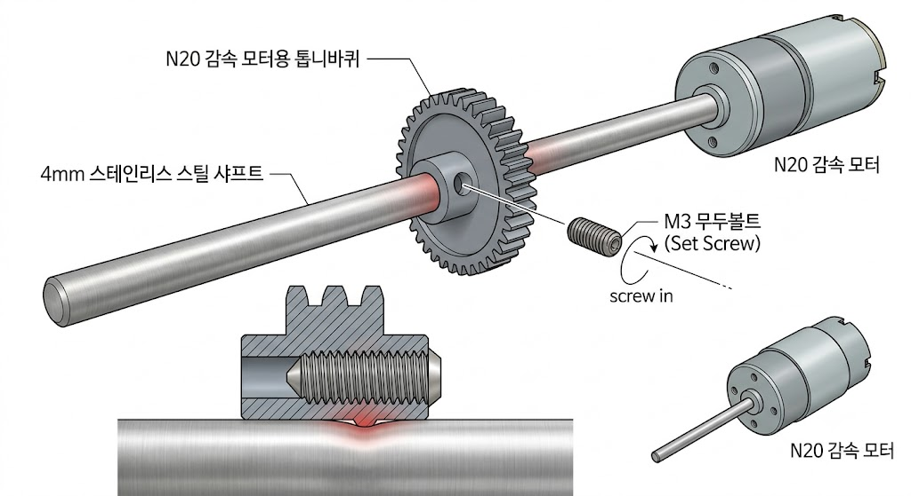

[consolidated snapshot...](https://www.google.com/search?q=Mini+Marble+Machine+No3&oq=Mini+Marble+Machine+No3&gs_lcrp=EgZjaHJvbWUyBggAEEUYOTIGCAEQRRg90gEHODMyajBqNKgCALACAQ&sourceid=chrome&source=chrome.ob&ie=UTF-8#fpstate=ive&vld=cid:c3a64bfa,vid:ZNXvmpQ5t24,st:0)

공유해주신 영상은 'Mini Marble Machine No3'라는 목재 마블 머신(구슬 순환 장치)입니다. 구슬이 회전하는 목재 휠의 구멍에 들어가 올라간 뒤, 상부 레일과 아크릴 스위치백 레일을 타고 다시 하부 집수 영역으로 돌아오는 방식으로 작동합니다.

이 작품을 직접 만들기 위해 필요한 부품, 목재, 모터/베어링 정보 및 구매 방법과 제작 순서를 정리해 드립니다.

---

## 1. 필요 부품 및 구매 가이드

목재 (원목 및 합판)** 
    • **바닥 및 프레임:** 자작나무 합판(12mm 또는 15mm)
 
리프트 휠 및 레일:** 미소형 소나무/자작나무 합판(6mm, 9mm)
    • *치수가 안정적이고 가공 시 결이 안 깨지는 자작나무 합판 권장* | 네이버 쇼핑 / 문고리닷컴 / 목재 절단 사이트
    * (검색어: `자작나무 합판 6mm`, `목재 재단`) |

감속 모터 (DC Motor)** 
    • **N20 감속 모터 (DC 5V~6V, 30~60 RPM)**
    • 회전속도가 너무 빠르면 구슬이 튀어나가므로 Low RPM 모터 필요 
    * 알리익스프레스 / 스마트스토어(검색어: `N20 감속모터 6V 30RPM`) |

베어링 (Bearing)** 
    • **플랜지 미니チュア 베어링 (F684ZZ 또는 F683ZZ)**
    • 회전축이 목재 프레임에 걸쳐 고정되도록 플랜지(날개)가 달린 베어링 사용 
    * 알리익스프레스 / 네이버 쇼핑 (검색어: `플랜지 베어링 F684ZZ`, `미니 베어링 4mm`) |

기어 (Gears)** 
    • 모터 축과 회전 휠 축을 연결하는 플라스틱 감속 기어 세트 | 디바이스마트 / 알리익스프레스 (검색어: `모듈0.5 감속기어`, `DIY 플라스틱 기어`) |

구슬 및 아크릴판** | 
    • **구슬:** 8mm ~ 10mm 강구 또는 유리구슬

아크릴판:** 2mm 투명 아크릴판 (스위치백 벽면 및 가이드용) | 문구점 / 네이버 쇼핑(검색어: `쇠구슬 10mm`, `투명 아크릴판 2mm`) |

전원 및 기타 부품** 
    • AA 건전지 홀더(또는 USB 5V 전원 케이블)

4mm 스텐 아우터 축 / 볼트 & 너트 세트 | 아두이노 부품 쇼핑몰 / 철물점 |

---

## 2. 핵심 메커니즘 및 구조 설명

1. **리프트 휠 (Wheel Lift):**
* 목재 원판에 구슬 크기보다 살짝 큰 구멍이 일정한 간격으로 뚫려 있습니다.
* 휠 뒤편에는 비스듬한 판이 대어져 있어, 휠이 돌 때 구슬이 떨어지지 않고 위로 끌려 올라갑니다.

2. **트리거 및 경사 레일:**
* 최상단에 도달하면 구슬이 기울어진 목재 가이드 레일로 배출됩니다.

3. **아크릴 스위치백 (Zig-Zag Track):**
* 구슬이 투명 아크릴 박스 내부를 좌우로 번갈아 떨어지며 감속 및 시각적 효과를 줍니다.

---

## 3. 제작 순서

1. **도면 작업 및 목재 가공:** 직소기 또는 레이저 가공기 필요.
1. 메인 베이스 판, 휠 지지대, 구슬 수거 박스의 치수를 도면으로 작성합니다.
2. 자작나무 합판에 휠 원형을 자르고 구슬이 들어갈 홀을 동일한 간격으로 타공합니다.
3. 베어링이 들어갈 축 구멍을 정확한 파이(Ø)에 맞게 타공합니다.

2. **구동부 및 축 조립:** 유격 및 마찰 최소화.
1. 메인 프레임에 플랜지 베어링을 끼워 넣습니다.
2. 4mm 샤프트(축)에 대형 기어와 회전 휠을 고정합니다.
3. 모터 축에 소형 피니언 기어를 끼우고 메인 기어와 톱니가 잘 맞물리도록 위치를 잡고 고정합니다.

3. **레일 및 아크릴 스위치백 제작:**
1. 2mm 아크릴판을 레이저 컷팅하거나 아크릴 칼로 자릅니다.
2. 아크릴 지지대 사이에 지그재그 경사판을 고정하여 구슬이 부드럽게 굴러내려오도록 각도를 맞춥니다.
3. 구슬이 바닥으로 낙하하여 다시 휠 입구로 모이는 경사 구배판을 만듭니다.

4. **전원 연결 및 테스트:** 속도 조절 및 구슬 걸림 수정.
1. N20 모터에 건전지 케이블과 스위치를 납땜 연결합니다.
2. 전원을 켜고 구슬을 넣어 상부 배출 시 걸림 현상이 없는지 확인하고 경사각을 미세 조정합니다.

샤프트에 기어 부착 (M3 무두볼트로 샤프트에 고정) 이것이 무슨 뜻인지 그림으로 보여줘

, AI로 생성
"M3 무두볼트로 샤프트를 꽉 조여서 고정한다"는 것은 샤프트(회전축)가 회전할 때 기어도 미끄러지지 않고 함께 회전하도록 물리적으로 결합하는 가장 일반적인 방법입니다.

제공해 드린 그림은 이 메커니즘을 상세하게 설명합니다.

그림 설명: 무두볼트 고정 방식 (Set Screw Locking)
전체 조립 분해 예시 (메인 이미지):

N20 감속 모터의 축(샤프트) 끝에 작은 플라스틱 톱니바퀴가 장착됩니다.

기어의 허브(중심)에는 가로 방향으로 나사 구멍이 뚫려 있습니다.

M3 무두볼트 (머리가 없는 L자 렌치용 볼트) 한 개가 분해되어 있으며, 이 구멍으로 들어가도록 안내선이 표시되어 있습니다.

핵심 단면도 (하단 상세):

가장 중요한 부분입니다. 기어 허브와 샤프트가 조립된 상태의 단면입니다.

M3 무두볼트를 L자 렌치로 끝까지 조이면, 볼트의 끝단이 샤프트의 표면을 강력하게 압착(또는 파고듦)합니다.

빨간색 하이라이트로 표시된 이 압착 지점이 바로 기어와 샤프트가 미끄러지지 않게 만드는 마찰력(또는 물리적 맞물림)을 생성합니다.

핵심 요약
무두볼트(Set Screw): 일반 볼트와 달리 머리가 없어 조립 후 밖으로 튀어나오지 않습니다. 회전하는 기어에 사용하기 적합합니다.

고정 원리: 나사산의 힘으로 볼트 끝이 샤프트 측면을 꽉 눌러, 샤프트의 회전력이 기어로 전달되도록 합니다.

주의사항: 그림처럼 매끈한 샤프트에 고정할 때는 무두볼트를 매우 강하게 조여야 하며, 진동이 심하면 풀릴 수 있으므로 나사 고정제(록타이트 등)를 함께 사용하기도 합니다.

이 메커니즘을 통해 모터가 돌면 샤프트가 돌고, 샤프트에 꽉 고정된 기어까지 안정적으로 함께 회전하게 됩니다.